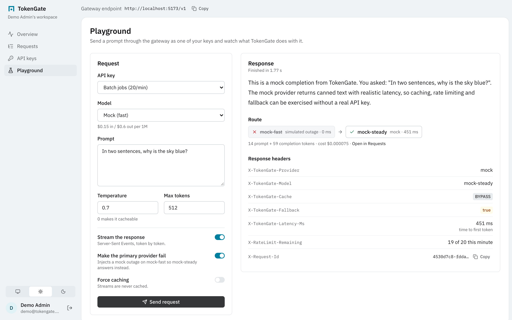
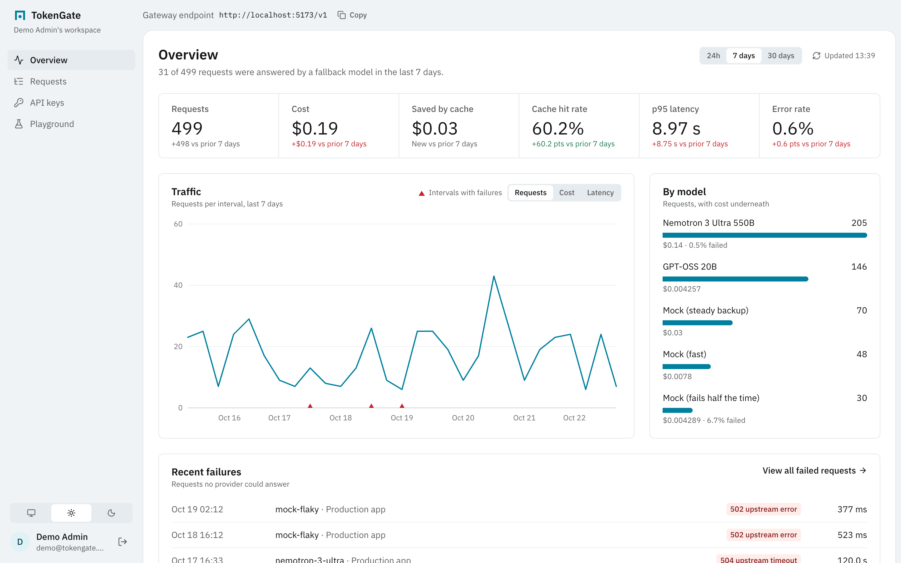
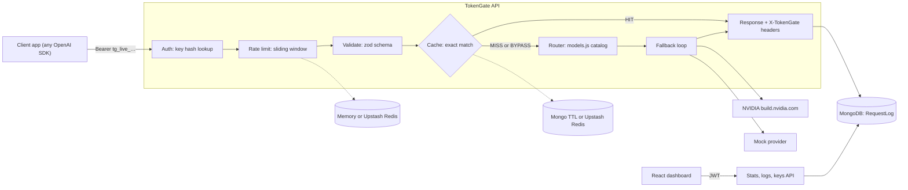
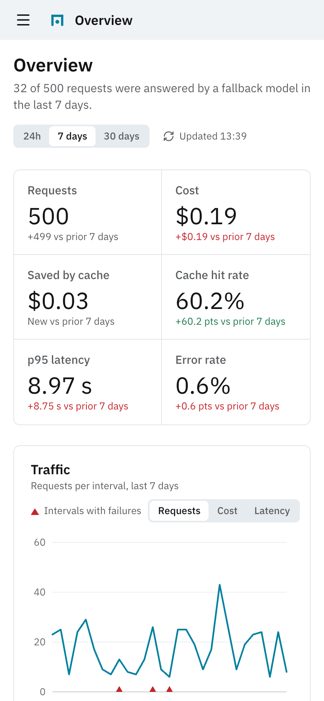
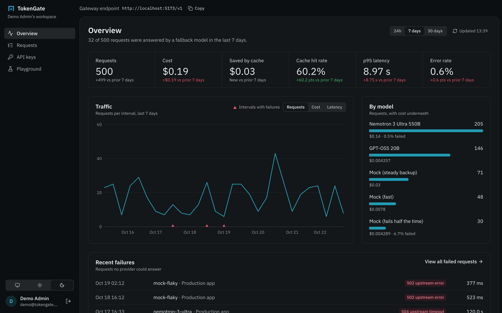

# TokenGate

[](https://github.com/your_github_user/tokengate/actions/workflows/ci.yml)

An OpenAI-compatible LLM gateway that authenticates apps with its own keys, caches, rate limits and fails over between providers, and shows what every request cost.

Your apps call TokenGate instead of a provider. TokenGate checks the app's key, applies its rate limit, answers from cache when it can, routes to a provider (falling back to the next one on an outage), logs tokens, cost and latency, and streams the answer back. Provider API keys live only in the server's environment. It is inspired by [Helicone](https://www.helicone.ai) and [Portkey](https://portkey.ai).

**Live demo:** `your_live_demo_url` (placeholder)



## What it does

TokenGate covers the gateway itself and a dashboard to watch it:

- **OpenAI-compatible API**: `POST /v1/chat/completions` and `GET /v1/models`, so any OpenAI SDK works by changing its base URL
- **Gateway API keys**: issued per app, stored only as SHA-256 hashes, shown once, revocable, each with its own rate limit
- **Automatic fallback**: each model lists fallback models; outages, timeouts and 429s move to the next one, client errors (4xx) do not
- **Exact-match caching**: temperature 0 (or `X-TokenGate-Cache: force`) responses are cached per user, in MongoDB or Upstash Redis
- **Rate limiting**: sliding window per key, in memory or in Upstash Redis via an atomic Lua script, with `Retry-After` on 429
- **Streaming**: Server-Sent Events proxied chunk by chunk, with usage captured from the final chunk
- **Usage and cost logging**: every request is logged with tokens, cost from configured prices, latency, cache status and the route it took
- **Dashboard**: overview with KPIs and charts, filterable request log with a route trace, key management, and a Playground that can force a provider outage
- **Providers**: NVIDIA's free [build.nvidia.com](https://build.nvidia.com) endpoints (Nemotron 3 Ultra 550B and GPT-OSS 20B) plus a mock provider for tests and keyless demos



## Architecture

TokenGate is a monorepo with an Express API in `server/` and a React dashboard in `client/`. Gateway traffic and dashboard traffic use separate authentication: apps send gateway keys to `/v1`, people sign in to the dashboard with a session token (JWT) for `/api`.



The server keeps one direction of dependency: routes wire middleware to controllers, controllers call services, and services call provider adapters. Route files hold no business logic. Gateway collaborators (model catalog, providers, cache store, rate-limit store) are built in `server/src/container.js`, which is how tests swap in mock-only catalogs and in-memory stores.

## Request lifecycle

A `POST /v1/chat/completions` request passes through these steps:

1. `requestId` assigns an `X-Request-Id` (or keeps a safe one the caller sent) used in every log line and error.
2. `requireApiKey` hashes the bearer key and finds it with one indexed lookup; revoked or unknown keys get a 401.
3. The rate limiter records the request in the key's sliding window, or returns 429 with `Retry-After`.
4. zod validates the body strictly: an unknown field is a 400, not silently dropped.
5. For a non-streaming request at temperature 0, the cache is checked. A hit returns immediately and is logged with `costUsd: 0` and `savedUsd` set to what the call would have cost.
6. The router takes the requested model and its fallbacks from `models.js` and calls the first provider, with a per-attempt timeout (30s by default).
7. On a retryable failure (5xx, 429, timeout, network error, missing provider key) the next model is tried. A 4xx from the provider goes straight back to the client.
8. Cost is computed from the provider's reported usage and the served model's prices. When usage is missing, tokens are estimated and the log says so.
9. The response is sent with `X-TokenGate-Provider`, `X-TokenGate-Model`, `X-TokenGate-Latency-Ms`, `X-TokenGate-Fallback` and `X-TokenGate-Cache`, and the request log is written after it.

Streaming requests follow the same path with three differences: they skip the cache, the response is committed only when the first upstream chunk arrives, and the timeout resets on every chunk so a long answer is never cut off.

## Design decisions and trade-offs

Each choice below names what it costs, not only what it buys.

### Gateway keys are SHA-256 hashes, not bcrypt hashes

Keys carry 192 bits of randomness, so brute-forcing a fast hash is out of reach, and a deterministic hash lets each request find its key with one indexed lookup. Measured on this project's machine, SHA-256 takes 0.8 µs per key while bcrypt takes 68 ms at cost 10 and 273 ms at cost 12, and bcrypt's per-hash salt would also rule out an indexed lookup. The plaintext is shown once at creation; a leaked database exposes no usable keys. The same reasoning does not apply to dashboard passwords, which are low-entropy and use bcrypt.

### The cache is exact-match only

An exact match on SHA-256 of the user, model, messages, temperature, `max_tokens` and every other output-affecting parameter is never wrong: the same input at temperature 0 should produce the same answer. Semantic caching (embedding similarity) would hit more often but can return an answer to a slightly different question, which is a correctness bug for most API traffic. Two choices follow from this. Keys are scoped per user, so one tenant never receives another's response or its savings. Non-zero temperatures are cached only when the client opts in with `X-TokenGate-Cache: force`.

### Fallback happens only before the first byte

Once a chunk reaches the client, the user may already be reading it. Switching providers mid-answer would splice two models' text into one response. TokenGate therefore holds the response headers until the first upstream chunk arrives, so a provider that accepts a request and fails immediately can still fall back. After the first byte, a failure ends the stream with an SSE `error` event and the partial answer stands. The cost of waiting is that time to first byte equals the provider's time to first token, which a gateway adds nothing to.

### Rate limiting and caching sit behind interfaces

`RateLimitStore` has one method, `hit(key, { limit, windowMs })`, and `CacheStore` has `get` and `set`. The in-memory limiter is exact and fast but per process; the Upstash limiter runs the same sliding-window log as one Lua script, so check-and-record is atomic across instances. The live test fires 6 concurrent requests at a limit of 3 and confirms exactly 3 are admitted. Swapping drivers is an environment variable, and no caller changes. If either store is unreachable, requests go through (fail open): a Redis outage costs rate limiting or a cache saving, never availability.

### Which upstream errors trigger fallback

A provider's 5xx, 429 and timeouts are its own problem, so another provider may succeed. A 401 or 403 from a provider means TokenGate's credential for it is wrong, which is also not the client's fault, so it falls back too and reports a 502. Any other 4xx means the request itself is invalid and would fail everywhere, so it returns to the client unchanged.

### Request logs are written after the response

Logging never adds latency to a request, and a failed log write never fails a request that already succeeded. The trade-off is that a crash in the few milliseconds after responding can lose that row. Prompts and completions are not stored unless `LOG_PROMPTS=true`.

### The dashboard session is a JWT in localStorage

A bearer token keeps the API stateless and the dashboard and gateway on one authentication style. An `httpOnly` cookie would protect the token from script access in an XSS but needs CSRF protection and credentialed CORS. With React's escaping and no third-party scripts, localStorage is a deliberate trade-off for this project; the session lasts 12h by default.

### Costs are reference market rates

NVIDIA's build.nvidia.com endpoints are free for prototyping and rate limited (community reports put the default at 40 requests per minute), so the configured prices are what the same models cost on a paid host, taken from OpenRouter on 2026-10-22. They are marked as placeholders in `server/src/config/models.js`, the only file that names models or prices.

## Models and pricing

`server/src/config/models.js` defines each model's provider, upstream id, prices, timeout and fallbacks. It is validated at startup, so a typo in a fallback id fails the deploy rather than a request. Prices are USD per 1M tokens.

| Model id           | Provider                                     | Input  | Output | Falls back to      |
| ------------------ | -------------------------------------------- | ------ | ------ | ------------------ |
| `nemotron-3-ultra` | NVIDIA (`nvidia/nemotron-3-ultra-550b-a55b`) | $0.50  | $2.20  | `gpt-oss-20b`      |
| `gpt-oss-20b`      | NVIDIA (`openai/gpt-oss-20b`)                | $0.018 | $0.09  | `nemotron-3-ultra` |
| `mock-fast`        | Mock, 150 ms                                 | $0.15  | $0.60  | `mock-steady`      |
| `mock-flaky`       | Mock, fails 50% of the time                  | $0.15  | $0.60  | `mock-steady`      |
| `mock-steady`      | Mock, 450 ms                                 | $0.30  | $1.20  | none               |

Nemotron runs with thinking off by default (`chat_template_kwargs.enable_thinking: false`); send `"chat_template_kwargs": {"enable_thinking": true}` to turn it on. GPT-OSS defaults to `reasoning_effort: "low"` so short prompts do not spend the whole `max_tokens` budget on reasoning.

## API reference

The gateway (`/v1`) authenticates with a TokenGate key; the dashboard API (`/api`) authenticates with the JWT returned by login. Every error has the same shape:

```json
{
  "error": {
    "code": "rate_limit_exceeded",
    "message": "Rate limit of 20 requests per minute exceeded; retry in 41s",
    "requestId": "3f1c…"
  }
}
```

### Chat completion

```bash
curl http://localhost:5001/v1/chat/completions \
  -H "Authorization: Bearer your_tokengate_key" \
  -H "Content-Type: application/json" \
  -d '{
    "model": "gpt-oss-20b",
    "messages": [{"role": "user", "content": "Why is the sky blue?"}],
    "temperature": 0
  }'
```

The body is the standard OpenAI chat completion. Send the same request again within an hour and `X-TokenGate-Cache: HIT` comes back, with no provider call.

### Streaming

```bash
curl -N http://localhost:5001/v1/chat/completions \
  -H "Authorization: Bearer your_tokengate_key" \
  -H "Content-Type: application/json" \
  -d '{
    "model": "nemotron-3-ultra",
    "stream": true,
    "stream_options": {"include_usage": true},
    "messages": [{"role": "user", "content": "Explain SSE in two sentences."}]
  }'
```

Chunks arrive as `data: {...}` events and end with `data: [DONE]`. The final usage chunk is included only when you ask for it with `stream_options.include_usage`.

### With the OpenAI SDK

```js
import OpenAI from 'openai';

const client = new OpenAI({
  apiKey: process.env.TOKENGATE_KEY,
  baseURL: 'http://localhost:5001/v1',
});

const completion = await client.chat.completions.create({
  model: 'nemotron-3-ultra',
  messages: [{ role: 'user', content: 'Hello' }],
});
```

### Request and response headers

These headers control or describe gateway behaviour:

| Header                                                                           | Direction | Meaning                                                                          |
| -------------------------------------------------------------------------------- | --------- | -------------------------------------------------------------------------------- |
| `X-TokenGate-Cache: force`                                                       | request   | Cache this response even if temperature is above 0                               |
| `X-TokenGate-Simulate-Failure: primary`                                          | request   | Fail the first provider on purpose to demo fallback (`ALLOW_FAILURE_SIMULATION`) |
| `X-TokenGate-Provider`                                                           | response  | Provider that answered, or `cache`                                               |
| `X-TokenGate-Model`                                                              | response  | Model that answered (differs from the request after a fallback)                  |
| `X-TokenGate-Latency-Ms`                                                         | response  | Gateway latency; time to first token for streams                                 |
| `X-TokenGate-Fallback`                                                           | response  | `true` when a fallback model answered                                            |
| `X-TokenGate-Cache`                                                              | response  | `HIT`, `MISS` or `BYPASS`                                                        |
| `X-RateLimit-Limit`, `X-RateLimit-Remaining`, `X-RateLimit-Reset`, `Retry-After` | response  | Rate limit state for the key                                                     |
| `X-Request-Id`                                                                   | both      | Correlates the response with its log entry                                       |

### Endpoints

| Method and path                                                          | Auth                       | Purpose                                                                                                          |
| ------------------------------------------------------------------------ | -------------------------- | ---------------------------------------------------------------------------------------------------------------- |
| `POST /v1/chat/completions`                                              | gateway key                | Chat completion, streaming or not                                                                                |
| `GET /v1/models`                                                         | gateway key                | Configured models in the OpenAI list format                                                                      |
| `POST /api/auth/register`, `POST /api/auth/login`                        | none (rate limited per IP) | Create an account or sign in; returns a JWT                                                                      |
| `GET /api/auth/me`                                                       | JWT                        | The signed-in user                                                                                               |
| `GET /api/keys`, `POST /api/keys`                                        | JWT                        | List keys; create one (the secret is in this response only)                                                      |
| `GET /api/keys/:id`, `PATCH /api/keys/:id`, `DELETE /api/keys/:id`       | JWT                        | Read, change name or rate limit, revoke                                                                          |
| `GET /api/stats/overview?range=24h\|7d\|30d`                             | JWT                        | Requests, cost, cache savings and hit rate, avg and p95 latency, error rate, fallbacks, plus the previous period |
| `GET /api/stats/timeseries?range=&metric=requests\|cost\|latency&tz=`    | JWT                        | Bucketed series in the viewer's time zone, empty buckets included                                                |
| `GET /api/stats/by-model?range=`                                         | JWT                        | Requests and cost per model that answered                                                                        |
| `GET /api/logs?page=&limit=&status=&model=&apiKeyId=&cached=&requestId=` | JWT                        | Paginated request logs, newest first                                                                             |
| `GET /api/logs/:id`                                                      | JWT                        | One request with its attempts                                                                                    |
| `GET /api/models`                                                        | JWT                        | Models with display names, prices, fallbacks and availability                                                    |
| `POST /api/playground/chat/completions`                                  | JWT + `X-TokenGate-Key-Id` | Runs a request as one of your keys (the dashboard never holds plaintext keys)                                    |
| `GET /health`                                                            | none                       | Liveness and database status                                                                                     |

## Run it locally

You need Node.js 22 or later and either Docker or a MongoDB 7+ server. With Docker, four commands start everything:

```bash
git clone your_repo_url tokengate && cd tokengate
cp server/.env.example server/.env
docker compose up --build -d
docker compose exec server npm run seed
```

Open http://localhost:5173 and sign in as `demo@tokengate.dev` with password `tokengate-demo`. The seed prints two API keys you can use with the curl examples. Add `NVIDIA_API_KEY` to `server/.env` to use the real models; without it, mock models work and NVIDIA models fail over to an honest 503.

Without Docker, point `MONGO_URI` in `server/.env` at your MongoDB (local or Atlas), then run `npm run install:all`, `npm run seed`, and `npm run dev:server` and `npm run dev:client` in two terminals.

### Send real requests

The seed fills the dashboard with demo traffic. Real traffic needs an NVIDIA API key, which is free: sign in at [build.nvidia.com](https://build.nvidia.com), open a model page and choose **Get API Key**, then set `NVIDIA_API_KEY` in `server/.env` and restart the server. Then follow these steps:

1. Sign in to the dashboard. Register a new account to see only your own traffic, or use the demo account.
2. Open **API keys**, create a key and copy it (it is shown once).
3. Send a prompt from the **Playground**, or run the curl example in the API reference with your key.
4. Open **Requests** to see the request with its route, tokens, cost and latency; **Overview** updates with it.

On the free tier GPT-OSS sometimes takes longer than 30s. TokenGate then times it out and Nemotron answers, which shows up as a fallback in the response headers and the request log.



## Environment variables

The server reads these once at startup in `server/src/config/env.js` and refuses to start if any are invalid:

| Variable                                             | Default                               | Purpose                                                        |
| ---------------------------------------------------- | ------------------------------------- | -------------------------------------------------------------- |
| `MONGO_URI`                                          | required                              | MongoDB connection string (local or Atlas)                     |
| `JWT_SECRET`                                         | required                              | Signs dashboard sessions; at least 32 characters               |
| `PORT`                                               | `5001`                                | API port                                                       |
| `CLIENT_URL`                                         | `http://localhost:5173`               | Origin allowed by CORS                                         |
| `JWT_EXPIRES_IN`                                     | `12h`                                 | Session lifetime                                               |
| `NVIDIA_API_KEY`                                     | empty                                 | Key for build.nvidia.com; empty disables the provider          |
| `NVIDIA_BASE_URL`                                    | `https://integrate.api.nvidia.com/v1` | Any OpenAI-compatible base URL works                           |
| `PROVIDER_TIMEOUT_MS`                                | `30000`                               | Per-attempt timeout; models can override it                    |
| `CACHE_DRIVER`                                       | `mongo`                               | `mongo` or `upstash`                                           |
| `CACHE_TTL_SECONDS`                                  | `3600`                                | How long a cached response lives                               |
| `RATE_LIMIT_DRIVER`                                  | `memory`                              | `memory` (one instance) or `upstash` (shared)                  |
| `DEFAULT_RATE_LIMIT_PER_MINUTE`                      | `20`                                  | Limit for keys without their own                               |
| `AUTH_RATE_LIMIT_PER_MINUTE`                         | `10`                                  | Login and register attempts per IP                             |
| `UPSTASH_REDIS_REST_URL`, `UPSTASH_REDIS_REST_TOKEN` | empty                                 | Required when either driver is `upstash`                       |
| `ALLOW_FAILURE_SIMULATION`                           | `true`                                | Allows `X-TokenGate-Simulate-Failure`                          |
| `LOG_PROMPTS`                                        | `false`                               | Store prompt and completion text in request logs               |
| `LOG_LEVEL`                                          | `info`                                | pino log level                                                 |
| `BCRYPT_ROUNDS`                                      | `12`                                  | Password hashing cost                                          |
| `TRUST_PROXY`                                        | `0`                                   | Reverse proxies in front, so per-IP limits see the real client |

The client reads `VITE_API_URL` (when the dashboard is served from another origin) and `VITE_DOCS_URL` (optional docs link in the top bar).

## Tests

The server has 190 Jest tests and the client has 21 Vitest tests. Server tests run against an in-memory MongoDB (mongodb-memory-server), make no network calls and never read `server/.env`:

```bash
npm test                                # server unit and integration tests
npm run test:coverage --prefix server   # plus coverage, with a floor CI enforces
npm test --prefix client                # client logic: formatting, deltas, ticks, SSE
npm run test:live --prefix server       # real Upstash checks, reads server/.env
```

Coverage is 95.8% of statements and 87% of branches; CI fails below 90% and 80%. The suites cover:

- **Unit**: cost calculation, cache keys, the sliding-window limiter on a fake clock, the fallback loop, the SSE parser split at every byte, timeouts and status mapping in the provider adapter against a real local HTTP server, time-zone bucketing across a DST change
- **Integration (Supertest)**: auth and session expiry, key creation and ownership, a successful completion and its log row, a cache HIT on the second identical request, 429 with `Retry-After`, fallback when the primary fails or times out, no fallback on a 4xx, streaming over real HTTP including client disconnects, every dashboard endpoint, and the seed script

GitHub Actions runs lint, format checks, tests and coverage for the server, and lint, tests and a production build for the client on every push.

## Project layout

The parts a reviewer will look for first:

```text
server/src/
  config/        env.js (validated env), models.js (models, prices, fallbacks)
  routes/        wiring only: middleware → controller
  controllers/   HTTP in and out
  services/      gateway/ (completion, streaming, fallback), cache/, rateLimit/, stats, logs, keys, auth
  providers/     OpenAI-compatible adapter, mock provider, error taxonomy
  middleware/    request id, auth, validation, rate limit, error handler
server/scripts/  seed.js and the demo traffic generator
client/src/
  pages/         overview, logs, keys, playground, auth
  components/    shell, charts (hand-drawn SVG), ui primitives
```

## How the dashboard was designed

The interface follows a written design brief rather than a component kit, in a "framed sheet" style: a blue-grey tinted frame around a white sheet, colour reserved for data, KPIs as type rather than tiles, and right-aligned tabular figures. It was reviewed against a craft and accessibility checklist, chart colours passed a colour-vision-deficiency validator in both themes, and the layout has no structural failures at 1440, 768 and 390 px.



## Future work

These are the next steps, roughly in order of value:

- **Semantic caching**: an embedding-similarity tier behind the exact-match cache, opt-in per key with a similarity threshold
- **Self-hosted Redis**: a TCP Redis driver (ioredis) next to Upstash's REST driver, and token-per-minute limits in addition to request limits
- **Budgets and alerts**: monthly spend caps per key, with webhook or email alerts at 80% and a hard stop at 100%
- **Multi-tenant teams**: organisations with roles, shared keys and per-team dashboards (the `role` field is the start)
- **Load balancing across keys**: several provider keys per provider, weighted or least-loaded, to raise free-tier rate limits
- **Wider API surface**: tool calling, embeddings and an OpenTelemetry trace per request
